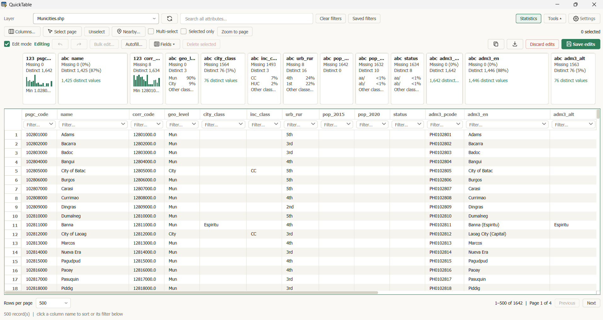

# ⚡ QuickTable

Search, filter and edit vector-layer attributes in QGIS—even tables without geometry.

**Development version 2.0.1** · QGIS 3.44+ (3.x) · By Iven Paul Rolloque



_Sample data: Philippine PSGC boundaries from [altcoder/philippines-psgc-shapefiles](https://github.com/altcoder/philippines-psgc-shapefiles)._

## ✨ Features

- **Find records:** Search all attributes, combine column filters, select multiple values and save filters.
- **Organize tables:** Sort, hide, resize and wrap columns; customize numeric display and browse by page.
- **Work with selections:** Sync rows with QGIS, show selected features and find nearby features.
- **Explore and clean data:** Save views and preview find-and-replace edits.
- **Edit attributes:** Update cells, bulk edit, autofill, manage fields and delete features with undo/redo.
- **Inspect and export:** View statistics across filtered results, copy rows and export CSV in the background.
- **Make it yours:** Choose light/dark themes, fonts, text size and window pinning.

## 📦 Install

**QuickTable 2.00 is available as a stable release** in the [QGIS Plugin Repository](https://plugins.qgis.org/).

1. Open **Plugins → Manage and Install Plugins**.
2. In **All**, search for **QuickTable**.
3. Select it and click **Install Plugin**. If already installed, use **Upgrade Plugin** when available.

Prefer a ZIP? Build the package below, choose **Install from ZIP** and select `quicktable_latest-2.0.1.zip`.

Restart QGIS after updating.

Requires QGIS **3.44 or later in the 3.x series**. No extra Python packages are needed. QGIS 4 is not supported.

## 🚀 Quick start

1. Open **QuickTable** from the Plugins menu or toolbar and choose a vector layer.
2. Type in **Search all attributes**, or click beneath a column name to filter. Click the name to sort.
3. Select rows to select features in QGIS. Use **Selected only** or **Nearby** to narrow the view.
4. Enable **Edit mode** to change writable cells, or use **Bulk edit** and **Autofill**. Choose **Save edits** to commit.
5. Turn on **Statistics**, copy rows, or **Export CSV** for selected rows, the current page or all filtered results.

### 💡 Keep in mind

- **NULL and blank text differ:** Right-click a writable cell to set NULL or empty text. Spaces are preserved.
- **Discard edits affects the whole layer**, including pending edits made elsewhere in QGIS.
- Search matches literal text; `%` and `_` are ordinary characters. Nearby distances use layer CRS units.
- Large result sets stay paginated. Export all matches directly through **Export CSV**.
- CSV uses visible columns and protects against spreadsheet formulas. NULL and empty text both export as blank cells.
- Find and replace works on one or all writable text fields, across selected rows, filtered results, or the entire layer. Preview changes before applying; they remain undoable until saved.

## 🛠️ Development

Run these commands from the repository root. Use **QGIS's Python environment** for the integration suite and package smoke test.

```sh
python -m unittest discover -s tests -v
python tests/run_qgis_tests.py
python tools/package_plugin.py
python tools/smoke_package.py
```

The build creates `dist/quicktable_latest-2.0.1.zip`. See the [remediation guide](https://github.com/ivxnzzz/quicktable_latest/blob/main/docs/remediation-guide.md) and [performance notes](https://github.com/ivxnzzz/quicktable_latest/blob/main/docs/performance.md) for validation details and limits.

Automated checks have been run on **Windows with QGIS 3.44.12**. Linux and macOS remain unverified.

## 💬 Support & license

Report bugs or request features through [GitHub Issues](https://github.com/ivxnzzz/quicktable_latest/issues). Include your QGIS version, OS and steps to reproduce.

© 2026 Iven Paul Rolloque · [GNU GPL v2 or later](LICENSE) · Distributed without warranty.
